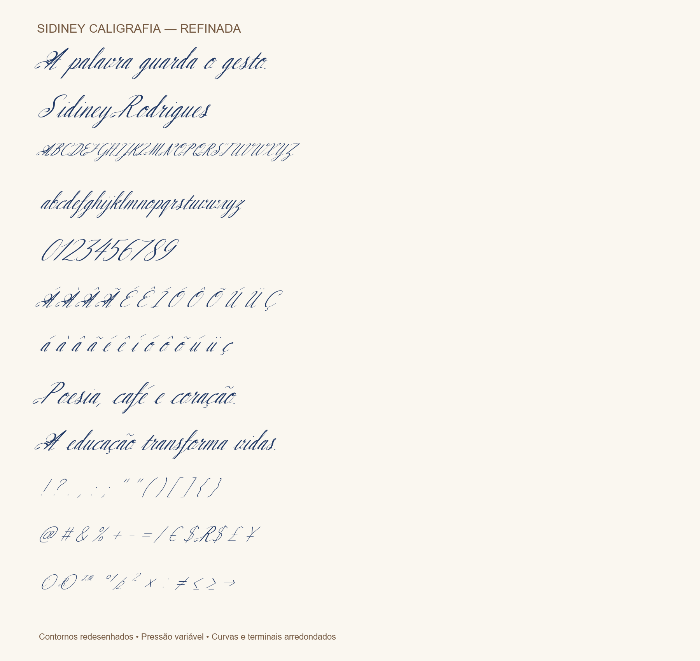

# CallGuide — Letras Cursivas

Aprenda o movimento das letras cursivas e pratique no papel digital. Aplicativo Android gratuito, offline e sem anúncios, para crianças e adultos.

## Site do projeto

[Conheça o CallGuide](https://sidineyr.github.io/callguid/) · [Download oficial do APK 2.1](https://github.com/sidineyr/callguid/releases/download/v2.1.0/CallGuide-2.1.apk)

O site inclui apresentação responsiva, instruções, privacidade, mapa do site, sitemap XML, metadados sociais e dados estruturados. A publicação ocorre pelo workflow `Site CallGuide e capturas Android`.

## Windows, Linux e macOS

O **CallGuide Desktop 2.2.0** permite escrever com **mouse ou caneta de mesa digitalizadora**, com pressão variável quando o dispositivo e seu driver fornecem esse dado. Inclui palavras animadas, modelo para traçar, borracha, desfazer, cores, ampliação e exportação do desenho em PNG. Funciona offline, sem anúncios.

**[⬇ Baixar versões desktop](https://github.com/sidineyr/callguid/releases/tag/desktop-v2.2.0)** · **[Diretório desktop e instruções](desktop/README.md)**

| Sistema | Arquivo |
|---|---|
| Windows x64 | [ZIP portátil](https://github.com/sidineyr/callguid/releases/download/desktop-v2.2.0/CallGuide-Desktop-2.2.0-windows-x64.zip) |
| Linux x64 | [TAR.GZ](https://github.com/sidineyr/callguid/releases/download/desktop-v2.2.0/CallGuide-Desktop-2.2.0-linux-x64.tar.gz) |
| macOS Intel | [ZIP](https://github.com/sidineyr/callguid/releases/download/desktop-v2.2.0/CallGuide-Desktop-2.2.0-macos-x64.zip) |
| macOS Apple Silicon | [ZIP](https://github.com/sidineyr/callguid/releases/download/desktop-v2.2.0/CallGuide-Desktop-2.2.0-macos-arm64.zip) |

Extraia o pacote inteiro. As versões desktop não possuem certificado comercial; o macOS usa assinatura ad-hoc, sem notarização Apple. O uso de uma mesa física e sua pressão dependem do driver e precisam ser conferidos no equipamento. [Veja os detalhes de instalação e validação](desktop/README.md).

## Fonte Sidiney Caligrafia Refinada

### [⬇ Baixar SidineyCaligrafia-Refinada.ttf](https://github.com/sidineyr/callguid/raw/80bf6f2d79ac7f85c2d7e68b4855ecf85211bd16/fonts/sidiney-caligrafia/SidineyCaligrafia-Refinada.ttf)

Letra inspirada na escrita com caneta esferográfica **BIC**. [Leia a publicação do autor no Substack](https://substack.com/home/post/p-223397084).

## Baixar e instalar

### [⬇ Baixar CallGuide para Android](https://github.com/sidineyr/callguid/raw/refs/heads/master/CallGuide.apk)

1. Abra esta página no celular Android e toque no link acima.
2. Abra o arquivo **CallGuide.apk** depois do download.
3. Se o Android pedir, permita que o navegador ou gerenciador de arquivos instale este aplicativo. O nome dessa opção varia conforme o aparelho.
4. Toque em **Instalar** e depois em **Abrir**. Após instalar, você pode desativar novamente a permissão de instalar por essa fonte.

Requer **Android 7.0 ou superior**. Se já instalou a versão 2.0 oficial deste repositório, instale esta por cima para atualizar. A instalação é direta pelo APK e não exige conta na Play Store nem pagamento. Mantenha a proteção do Android ativada e confira os avisos apresentados pelo aparelho.

Se você instalou um APK de teste anterior e o Android recusar a atualização por diferença de assinatura, desinstale a versão de teste antes de instalar esta. As próximas atualizações oficiais devem usar a mesma chave desta distribuição.

## Novidades da versão 2.1

- Digite seu nome, palavras ou frases curtas de até 32 caracteres.
- Veja a palavra inteira sendo escrita, com pausa, repetição e três velocidades.
- Desenhe sobre o mesmo modelo cursivo, com opção de ocultá-lo.
- Use caneta verde, azul ou vinho, ajuste a espessura, apague com a borracha ou desfaça o último traço.
- Amplie palavras longas e mova o papel pelas barras de controle.
- Salve até 12 palavras favoritas neste aparelho e exclua-as quando quiser.
- Português com acentos e ç, maiúsculas, minúsculas, números, espaços e os sinais . , - '.
- Ative a numeração dos traços na animação; a mesma opção acompanha o modelo de prática.

## O que há no aplicativo

- 26 letras maiúsculas e 26 minúsculas, com animações curtas de escrita cursiva.
- Traços com variação de espessura: descidas fortes e subidas leves.
- Controles para pausar, repetir e escolher outra letra.
- Papel digital para desenhar com o dedo.
- Ilustração de abertura de um pequeno príncipe indígena imaginário, criada com IA.

## A letra e sua inspiração

O CallGuide é inspirado na letra da fonte **Sidiney Caligrafia Refinada** e no seu uso com caneta esferográfica **BIC**. A fonte foi publicada pelo autor no [Substack](https://substack.com/home/post/p-223397084). A variação de espessura exibida pelo aplicativo é uma simulação visual para acompanhar o gesto da escrita; não mede a pressão física da caneta ou do dedo.

O arquivo está preservado no histórico do próprio repositório. Depois de baixar, você pode instalar a fonte no computador pelos recursos do seu sistema operacional.

## Privacidade e contato

Este APK não contém SDK de anúncios e não solicita permissão de acesso à internet. Não exige cadastro, não envia desenhos ou palavras e não salva o papel digital. Apenas as palavras que você decidir salvar ficam no armazenamento privado do aplicativo; elas podem ser excluídas na área de palavras. O backup automático está desativado. O link da política de privacidade abre no navegador do usuário.

Suporte: **sidiney@edu.univali.br**. Política: [privacidade do CallGuide](https://sidineyr.github.io/callguide/privacy/).

## Sobre esta distribuição

Versão **2.1.0**, pacote `com.sidineyr.callguide`. O APK é uma compilação de release, assinada com a chave do responsável pelo projeto. A soma de verificação está em [SHA256SUMS.txt](SHA256SUMS.txt).

Compilação, assinatura, manifesto, composição de palavras e testes automatizados de fluxo verificados. O teste manual desta versão em aparelho Android ainda está pendente; relate problemas pelo contato acima.

O repositório reúne o APK Android, o site do projeto, o diretório desktop, instruções, verificações de integridade e licença. O [código da versão 2.1](https://github.com/sidineyr/callguid/tree/source/2.1.0) está em uma branch própria. O histórico anterior continua preservado, sem ocupar a lista principal de arquivos. Distribuição sob [licença MIT](LICENSE).
