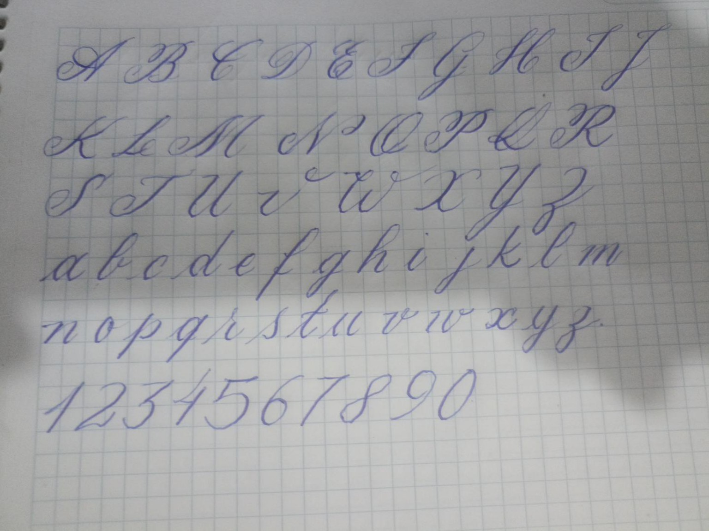
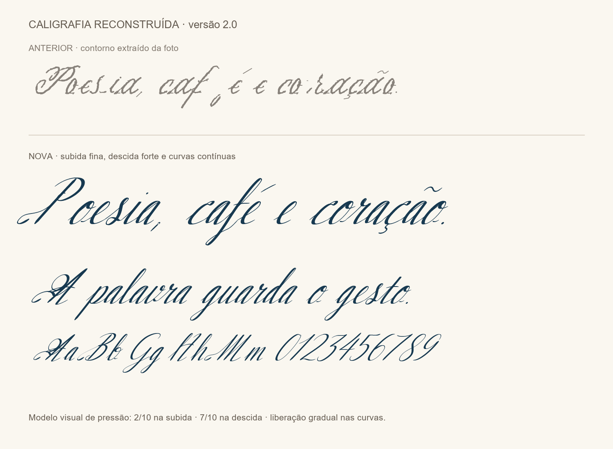

# Sidiney Caligrafia Refinada

Uma fonte TrueType inspirada em um **gabarito manuscrito de Sidiney Rodrigues**, fotografado em papel quadriculado. Publicada como resultado complementar ao projeto CallGuide: um exemplo de passagem da escrita manual para uma família tipográfica utilizável.

O gabarito orientou a inclinação, as proporções e os floreios. A versão final é uma **interpretação caligráfica redesenhada**, e não uma cópia mecânica dos pixels ou um fac-símile exato. As letras e os números foram reconstruídos com percursos curvos de pena; acentos e sinais ausentes da amostra foram desenhados para completar o uso em português.

## Baixar e instalar

- [Fonte TTF — versão 2.001](SidineyCaligrafia-Refinada.ttf?raw=true)
- [Pacote com fonte, gabarito, prévias, documentação e código](Caligrafia-Refinada.zip?raw=true)
- [Gabarito original](gabarito-original.jpg)
- [Folha de amostras](previas/Previa-Caligrafia-Refinada.png)
- [Cobertura dos 353 caracteres](coverage.json)

No Windows 10, baixe o TTF, abra-o com dois cliques e selecione **Instalar** ou **Instalar para todos os usuários**. Reabra o editor de texto e procure a família **Sidiney Caligrafia Refinada**. Não é necessário extrair arquivos diretamente na pasta de fontes do Windows.

## Do gabarito ao resultado



A primeira tentativa reproduzia interrupções de tinta, ruído do papel e contornos irregulares da fotografia. O redesenho substituiu esses contornos por curvas suaves e terminais arredondados, com contraste entre os movimentos da pena.



O modelo visual considera aproximadamente **2/10 de pressão na subida e 7/10 na descida**, com carga e liberação graduais nas curvas. São parâmetros de desenho: uma foto não permite medir a pressão física original. Os filetes usam 12 unidades e as hastes chegam a 48 em uma escala de 1000 unidades por em.

As entradas e saídas das minúsculas compartilham uma altura para melhorar a continuidade das palavras. Algumas ligações e detalhes podem variar conforme a combinação das letras e o programa utilizado. A fonte contém 353 caracteres, incluindo letras, números, acentuação portuguesa, pontuação, moedas e sinais usuais; não cobre todo o Unicode.

## Código e reprodução

Os percursos de pena e o modelo de espessura estão em [`src/calligraphy.py`](src/calligraphy.py). A montagem do TTF, dos acentos, dos sinais e da folha de amostras está em [`src/build_font.py`](src/build_font.py). O código não precisa da foto para reconstruir a versão refinada: o gabarito é a referência visual, e os percursos redesenhados são a fonte do desenho final.

Com Python 3.12, a partir desta pasta:

```bash
python -m venv .venv
# Windows: .venv\Scripts\activate
# Linux/macOS: source .venv/bin/activate
python -m pip install -r requirements.txt
python src/build_font.py
python src/validate_font.py gerado/SidineyCaligrafia-Refinada.ttf
```

Os novos arquivos são gravados em `gerado/`. Para outro destino, use `--output-dir CAMINHO`. A opção `--label-font CAMINHO.ttf` permite escolher a fonte das legendas da prévia; ela não altera as letras da fonte caligráfica.

A publicação inclui a versão aprovada do TTF e suas prévias. A validação verifica abertura do arquivo, leitura dos contornos, métricas, cobertura básica em português e renderização de frases. Isso não equivale a testar todos os editores ou todas as combinações possíveis de caracteres.

## Ajuste da versão 2.001

O F maiúsculo recebeu a pressão de descida na haste principal, mantendo seu percurso, floreios e largura de avanço. Os demais caracteres conservam os contornos publicados.

## Autoria e licença

Gabarito e direção caligráfica: **Sidiney Rodrigues**. Redesenho vetorial e implementação em Python desenvolvidos com assistência do Codex, a partir do gabarito e das orientações do autor.

Distribuído conforme a [licença MIT do repositório](../../LICENSE), reproduzida em [LICENSE](LICENSE). As dependências mantêm suas próprias licenças e não estão incorporadas ao pacote.
